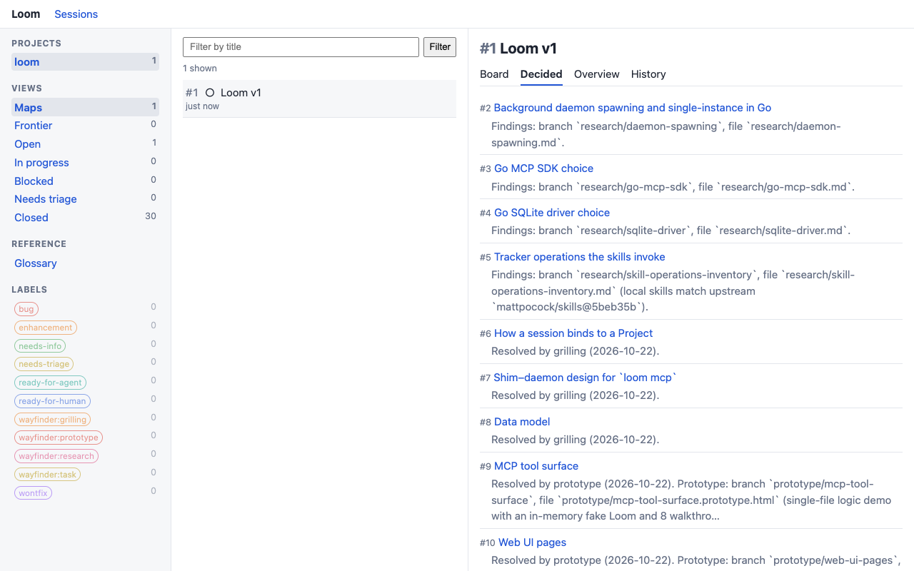
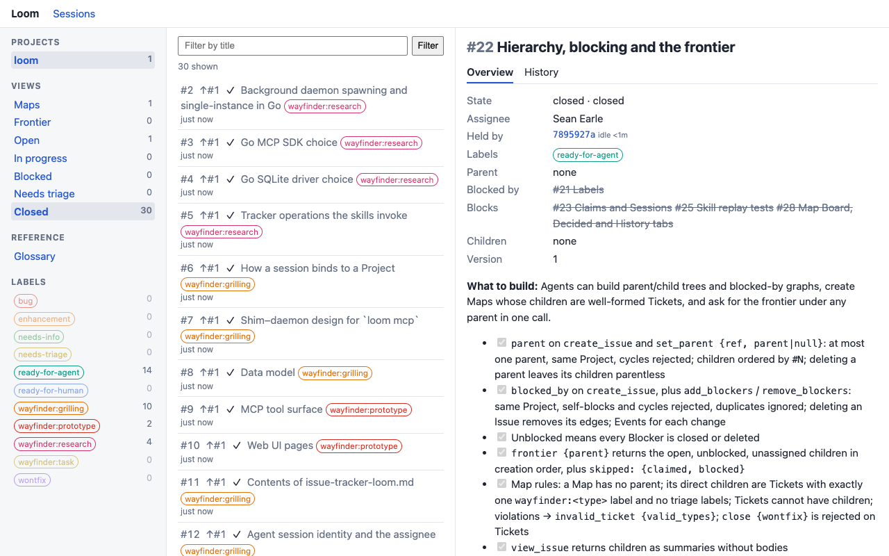

# Loom

A local-first issue tracker that agents drive through [MCP](https://modelcontextprotocol.io). It is built to be the issue tracker for the [`mattpocock/skills`](https://github.com/mattpocock/skills) engineering skills: agents create, claim, and close Issues; you watch in a web UI.

- **Local**: one SQLite database under `~/.loom`. No account, no hosted service, nothing leaves your machine.
- **Agent-driven**: all writes go through MCP tools. There is no CLI or web write path.
- **Human-observable**: a read-only web UI on `http://127.0.0.1:7337` shows what your agents are doing as they do it.
- **Wayfinder-aware**: Maps, child Tickets, native blocking, and a Frontier query support the `/wayfinder` skill.



_Screenshots show Loom's own v1 planning, loaded into Loom._

## Install

Requires Go (see `go.mod` for the version). macOS and Linux.

```sh
go install github.com/HellRok/loom@latest
```

Or build from source:

```sh
git clone https://github.com/HellRok/loom && cd loom
go build -o loom .
```

## Quickstart

1. **Install Loom in a repo.** From the repo's root:

   ```sh
   loom init
   ```

   This creates a Project for the repo, writes the tracker doc, and points the repo's `## Agent skills` block at Loom. Run `/setup-matt-pocock-skills` first if you use those skills.

   For a repo you can't (or don't want to) add files to, use `loom init --standalone`. It writes nothing under the repo and keeps the skill config, including the domain Glossary, in Loom.

2. **Register the MCP server** in your agent harness. See [Adding Loom to your agent](#adding-loom-to-your-agent).

3. **Work as usual.** Agents publish and triage Issues, claim the next one off the Frontier, and close it with a comment. Open `http://127.0.0.1:7337` to follow along.

## Adding Loom to your agent

Loom is a stdio MCP server named `loom`, run with the command `loom mcp`. Register it once, globally, so it works in every repo: the Project is resolved from the agent's working directory. The `loom` binary must be on the `PATH` your agent runs with (`go install` puts it in `$(go env GOPATH)/bin`).

**Claude Code**

```sh
claude mcp add --scope user loom -- loom mcp
```

**OpenCode**: add to `opencode.json` (or `~/.config/opencode/opencode.json` for every repo):

```json
{
  "mcp": {
    "loom": { "type": "local", "command": ["loom", "mcp"] }
  }
}
```

**Codex**: add to `~/.codex/config.toml`:

```toml
[mcp_servers.loom]
command = "loom"
args = ["mcp"]
```

**Pi**: add to `~/.pi/mcp.json`

```sh
pi mcp add loom
```

**Anything else** (Cursor, Gemini CLI, Windsurf, ...): most harnesses read an `mcpServers` map like the one above from their MCP config file. Use command `loom`, args `["mcp"]`.

Check it worked by asking your agent to run `list_projects`, or open the web UI and look for the Session on the Sessions page.

Some harnesses ignore MCP server instructions. For those, `loom init` prints an optional line to add to your global agent memory (for example `~/.claude/CLAUDE.md`).

## The web UI

The sidebar gives views over a Project's Issues (Maps, Frontier, Open, In progress, Blocked, Needs triage, Closed), its Labels, and, for Standalone Projects, its Glossary. Selected Labels and the title filter narrow every View's count, and following a View keeps them. A Label's count is the number of Issues in the current View, so narrowed, that carry it.

- **Frontier**: the open, unblocked, unclaimed Issues, in creation order. This is what an agent takes next.
- **Maps**: a wayfinder effort indexed as one Issue. The Board tab sorts its Tickets into Frontier, Claimed, and Blocked; the Decided tab (above) lists the closed Tickets with a gist of each answer.
- **Issues**: state, assignee, the Session holding it, Labels, parent, Blockers, and the discussion thread.



## How it works

- `loom mcp` is a thin stdio shim that your agent harness launches. It starts the daemon if needed and proxies MCP to it.
- `loom serve` is the daemon. It owns the Loom home's lock and SQLite database, and serves `/mcp` and the web UI on one port. One daemon serves one Loom home.
- A **Project** is anchored to a directory, its **Root**. The shim resolves the Project from the agent's working directory (the deepest Root wins), so the same `loom mcp` command works in every repo.
- Each agent connection is a **Session**. `claim` records which Session holds an Issue, so concurrent agents don't take the same one.

See [`GLOSSARY.md`](GLOSSARY.md) for the full vocabulary (Issue, Project, Root, Standalone, Map, Ticket, Blocker, Frontier, Claim, Session) and [`docs/adr/`](docs/adr/) for design decisions.

### Configuration

Optional. Loom reads `config.toml` from the Loom home (`$LOOM_HOME`, default `~/.loom`):

```toml
port = 7337          # default
listen = "127.0.0.1" # default; the UI and MCP endpoint are unauthenticated, so keep it loopback
assignee = "Your Name" # default: git's global user.name, else $USER
```

## Commands

| Command | What it does |
| --- | --- |
| `loom init [--standalone] [--slug <slug>]` | Install Loom as this repo's issue tracker |
| `loom mcp` | Serve MCP over stdio, starting the daemon if needed |
| `loom serve` | Run the daemon (normally started for you by the shim) |
| `loom stop` | Stop the daemon gracefully |
| `loom project mv <slug> [dir]` | Rebind a Project's Root |
| `loom project rm <slug>` | Delete a Project and everything in it |

## Development

```sh
go test ./...                              # unit and handler tests
go test -tags system ./internal/systest/   # system tests: a real daemon, driven in headless Chrome
```

The system tests use the locally installed Chrome. Enable the pre-commit hook once per clone; it runs gofmt, `go vet`, `go fix -diff`, and both test suites:

```sh
git config core.hooksPath .githooks
```

Issues for Loom itself are tracked in Loom. See [`AGENTS.md`](AGENTS.md) and [`docs/agents/`](docs/agents/).
